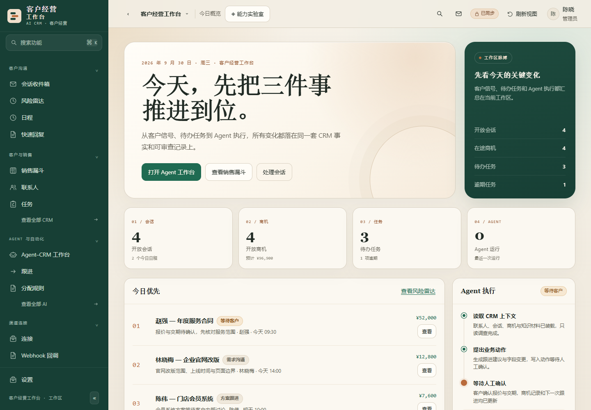
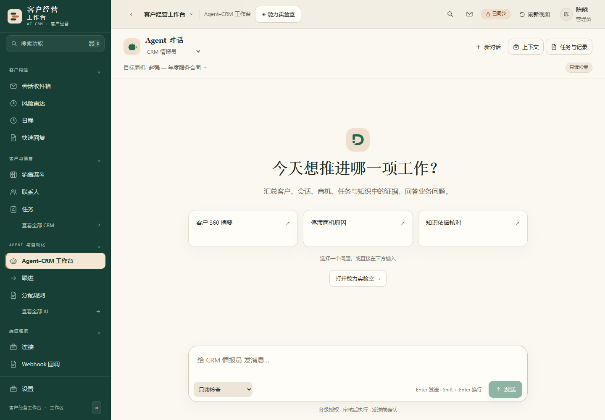
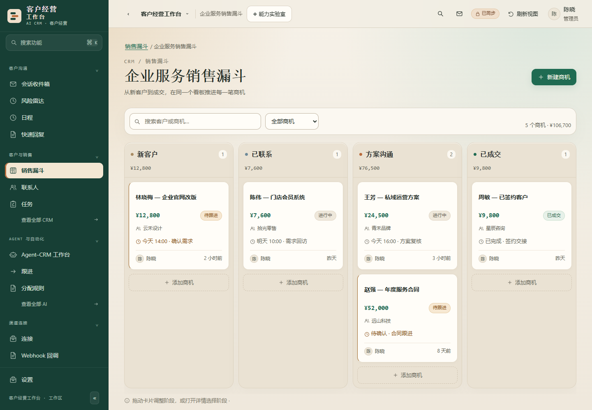
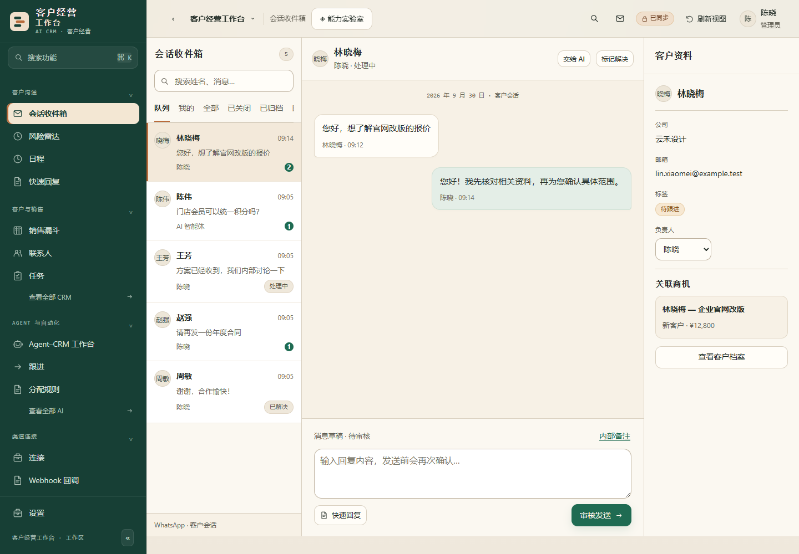
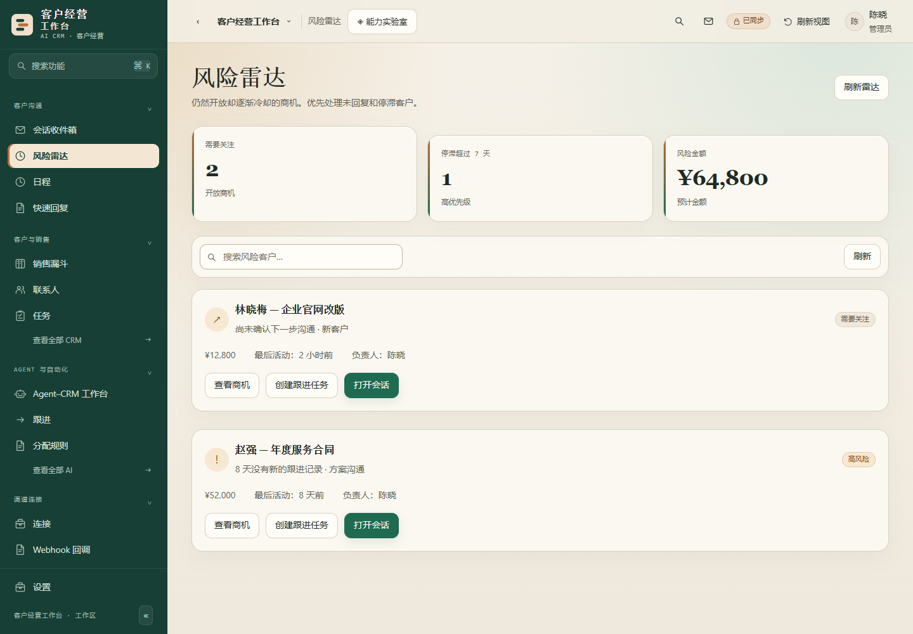
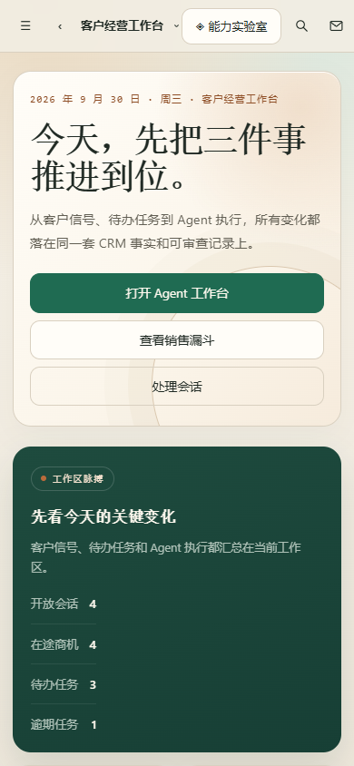
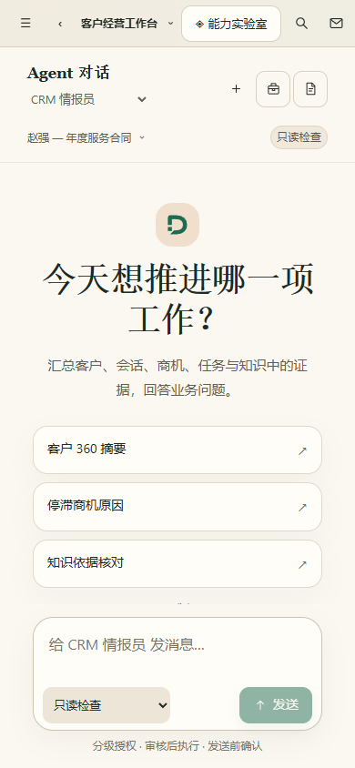

# 客户经营工作台

把客户、商机、会话、任务和 Agent 执行放进同一个工作区的 CRM。前端是 Next.js，数据与鉴权在 Supabase，Agent 运行在可独立部署的 worker 中。



## 这是什么

- 一套可以自己部署、自己接模型、自己接 WhatsApp 的客户经营系统。
- 联系人、销售漏斗、会话收件箱、任务、日程、知识库、Agent 工作台和审计记录共用一套数据。
- Agent 的读写经过工具端口、权限、预算和人工确认，不直接把数据库交给模型。
- 默认中文界面，内置浅色与深色主题；侧栏、卡片、表单和看板使用统一的暖色设计令牌。

## 这不是什么

- 不是只读的界面模板，也不是纯前端 mock。没有 Supabase 时页面无法进入工作区。
- 不包含任何真实客户数据、真实模型密钥或真实 WhatsApp 会话。
- 不承诺开箱即用的托管服务。你需要自己的 Supabase、Redis 和模型凭据。

## 界面

| 工作台 | 销售漏斗 |
| --- | --- |
|  |  |

| 会话收件箱 | 风险雷达 |
| --- | --- |
|  |  |

移动端：

<p>
  
  
</p>

## 核心能力

- **客户与销售**：联系人、标签、销售漏斗、阶段、商机金额、跟进任务、活动时间线。
- **会话收件箱**：WhatsApp 会话、分配、转接、暂停 AI、快速回复、内部备注。
- **Agent 工作台**：选择内置 Agent 和 CRM 对象，让 Agent 读取上下文、提出动作、等待确认并留下执行轨迹。
- **知识与记忆**：本地 RAG、组织知识源、客户确认事实、可追溯引用。
- **自动化**：分配规则、跟进流程、Webhook、定时任务和可审计的工具调用。
- **经营分析**：漏斗、绩效、AI 用量、审计日志、风险雷达。
- **多租户**：组织隔离、角色权限、邀请成员、按组织绑定模型与渠道。

## 技术栈

- Next.js 16 + React 19 + TypeScript
- Tailwind CSS 4
- Supabase（Postgres、Auth、Storage、RLS）
- Upstash Redis（队列与限流）
- Vercel AI SDK / OpenAI / Anthropic / Google / OpenRouter
- Vitest + Playwright

Agent 的 CRM 读写、审批、预算和事件流都在本仓库内；模型只是执行链中的一环。

## 快速开始

下面这条路径适合本地开发和一台自己的服务器。全程约 15 分钟。

### 1. 准备环境

- Node.js 22 或更新版本
- pnpm 9.x（仓库锁定 `pnpm@9.15.9`）
- 一个 Supabase 项目（云端免费层即可）
- 一个 Upstash Redis 数据库（免费层即可）

```bash
corepack enable
corepack prepare pnpm@9.15.9 --activate
pnpm install --frozen-lockfile
```

如果系统没有 Corepack，也可以直接运行 `npx pnpm@9.15.9 install --frozen-lockfile`。

### 2. 配置环境变量

```bash
cp .env.example .env.local
```

Windows PowerShell：

```powershell
Copy-Item .env.example .env.local
```

至少填写下面这些值：

| 变量 | 从哪里获取 |
| --- | --- |
| `NEXT_PUBLIC_SUPABASE_URL` | Supabase → Project Settings → API |
| `NEXT_PUBLIC_SUPABASE_ANON_KEY` | Supabase → Project Settings → API |
| `SUPABASE_SERVICE_ROLE_KEY` | Supabase → Project Settings → API（只放服务端） |
| `SUPABASE_DB_URL` | Supabase → Project Settings → Database → Connection string → URI |
| `UPSTASH_REDIS_REST_URL` | Upstash → Redis → REST API |
| `UPSTASH_REDIS_REST_TOKEN` | Upstash → Redis → REST API |
| `NEXT_PUBLIC_APP_URL` | 本地 `http://localhost:3000`，线上填正式域名 |
| `AI_CRED_AES_KEY` | 32 字节 Base64，见下方命令 |
| `INTERNAL_SECRET` | 32 字节以上随机字符串 |
| `CPF_ENCRYPTION_KEY` | 随机字符串 |
| `WAHA_BYO_ENCRYPTION_KEY` | 随机字符串 |

`SUPABASE_DB_URL` 建议使用 Supabase 控制台的 **Session pooler** 连接串（端口 5432）或 **Direct connection**。`pnpm db:init` 会一次执行完整 schema，事务模式连接串（端口 6543，通常带 `pgbouncer=true`）在部分项目上会限制建表和扩展，不建议用于首次初始化。

生成密钥：

```bash
node -e "console.log(require('crypto').randomBytes(32).toString('base64'))"
node -e "console.log(require('crypto').randomBytes(32).toString('hex'))"
```

`AI_CRED_AES_KEY` 必须是第一条命令输出的 32 字节 Base64。其余密钥使用第二条命令的输出即可。

如果暂时不接 WhatsApp，`WAHA_API_BASE_URL`、`WAHA_API_KEY`、`WAHA_WEBHOOK_BASE_URL` 可以填写占位值让生产进程启动；不要打开渠道连接，系统不会主动外发消息。

### 3. 初始化数据库

在 Supabase 的 SQL 连接串已填入 `SUPABASE_DB_URL` 后：

```bash
pnpm db:init
```

脚本会启用 `vector`、`citext`、`pg_trgm`，然后应用 `supabase/baseline.sql`。这是新数据库的唯一初始化入口，不要用 `supabase db push` 代替。

如果数据库已经有 `public.organizations`，脚本会直接跳过，不会覆盖现有数据。

### 4. 启动

```bash
pnpm dev
```

打开 `http://localhost:3000`：

1. 注册第一个账号。
2. 完成组织名称、漏斗和邀请步骤。
3. 进入「Agent 与自动化 → 凭据」，绑定 OpenAI、Anthropic、Google 或兼容接口的密钥。
4. 打开「Agent 工作台」，选择一个内置 Agent 和一个 CRM 对象开始运行。

如果你用 Supabase 云端项目做本地开发，Supabase 的 Auth 配置里需要把 Site URL 设为 `http://localhost:3000`，并允许 `http://localhost:3000/auth/confirm` 作为跳转地址。

### 5. 可选：初始化一组样例数据

只有在本机 Supabase（`127.0.0.1` / `localhost`）并且 `CRM_DEMO_MODE=true` 时，下面的脚本才会执行：

```bash
pnpm db:seed-samples
```

脚本会创建一组带联系人的销售漏斗、任务和会话，方便先看完整界面。它拒绝连接云端生产库。

## 部署到线上

### Vercel + Supabase（推荐先跑通）

1. 在 Vercel 导入本仓库。
2. 把 `.env.local` 里的变量填进 Vercel Project Settings → Environment Variables。
3. Build Command 使用 `pnpm build`，Install Command 使用 `pnpm install --frozen-lockfile`。
4. 部署后把 Supabase Auth 的 Site URL 和 Redirect URLs 改成正式域名。
5. 在 Supabase 执行一次 `pnpm db:init`（在本地运行即可，连接的是云端数据库）。

`next.config.ts` 会自动识别 `VERCEL`，关闭 `standalone` 输出，不需要改代码。

### 自己的服务器

```bash
pnpm install --frozen-lockfile
pnpm build
pnpm start
```

需要后台执行 Agent 时，再启动一个常驻进程：

```bash
pnpm worker
```

如果不想维护 worker，可在环境变量中设置 `AGENT_DISPATCH_CONSUMER=native`，让 Next 进程内的调度器消费事件；功能相同，吞吐和隔离性较弱。

Cron、WhatsApp（WAHA）、语音和对象存储都是可选模块。只使用 CRM、销售漏斗、任务和 Agent 工作台时，可以先不配置它们。

## 常用命令

| 命令 | 用途 |
| --- | --- |
| `pnpm dev` | 启动开发服务 |
| `pnpm build` / `pnpm start` | 生产构建与启动 |
| `pnpm typecheck` | TypeScript 检查 |
| `pnpm lint` | ESLint |
| `pnpm test:unit` | 单元测试 |
| `pnpm worker` | Agent 执行进程 |
| `pnpm dev:crons` | 本地定时任务辅助进程 |
| `pnpm db:init` | 初始化空数据库 |
| `pnpm db:seed-samples` | 仅本地：写入一组样例数据 |

## 目录

| 目录 | 内容 |
| --- | --- |
| `app/` | 页面、路由和产品 API |
| `components/` | 工作台、侧栏、表单、看板等界面组件 |
| `lib/` | CRM 领域逻辑、权限、Agent Harness、知识检索、模型适配 |
| `workers/` | Agent 执行和后台任务 |
| `supabase/` | 基线 schema、迁移和 RLS |
| `scripts/` | 数据库初始化、种子数据和辅助脚本 |
| `tests/` | 单元、数据库和浏览器测试 |
| `docs/` | 部署、架构和界面截图 |

## 品牌与二次分发

产品名、Logo 和主题都可以通过环境变量或组织设置替换：

- `APP_NAME`：安装级产品名
- `APP_LOGO_URL`：安装级 Logo
- `APP_ACCENT_HEX`：主题强调色

组织管理员还可以在「设置 → 品牌」里覆盖当前工作区的名称、Logo 和颜色，不影响其他组织。

本仓库基于 MIT 许可的 AiNativeCrm 修改，保留原始版权声明。修改范围见 [NOTICE.md](NOTICE.md)。

## 许可

[MIT](LICENSE)。Copyright (c) 2026 Rafael Melgaço。
